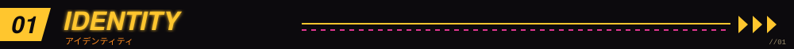
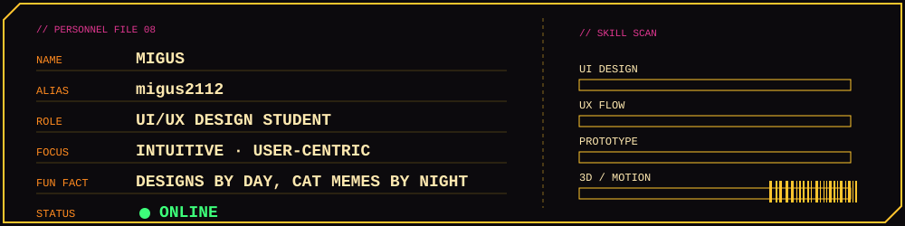
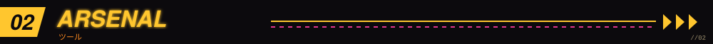
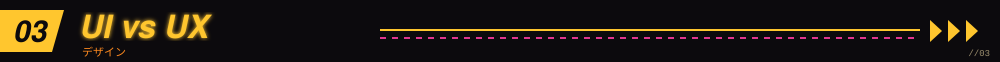
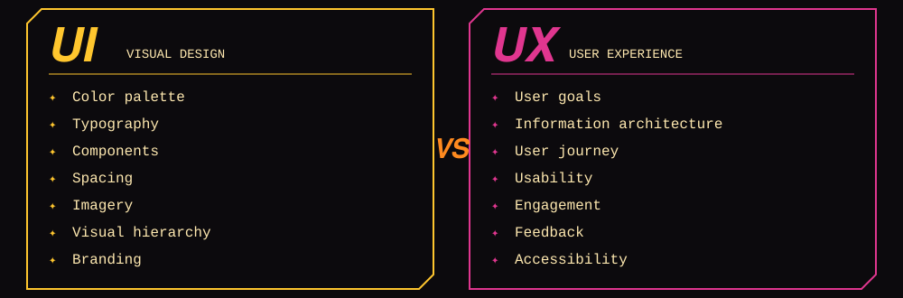
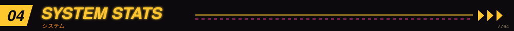
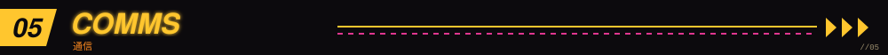

Mahasiswa yang lagi aktif ngasah skill UI/UX design, dengan pemahaman dasar soal bikin pengalaman pengguna yang intuitif. 
Passionate bikin antarmuka yang berpusat pada pengguna, dan selalu semangat belajar hal baru.

 

 

